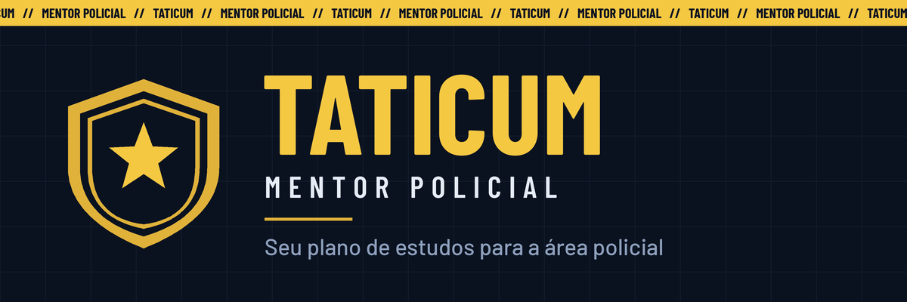

# Ativar as contas (Supabase) — passo a passo do dono

Leva cerca de 40 minutos. Faça uma vez. Enquanto isso não for feito, o app funciona **sem contas**, como nas versões anteriores.

> **Regra de ouro:** existem duas chaves no Supabase. A **publishable** (ou *anon*) pode ir para o app. A **secret** (ou *service_role*) **nunca** sai do painel: não mande por mensagem, não coloque no GitHub, não cole no app. Quem tem essa chave tem acesso total ao banco.

## 1. Criar o projeto

1. Acesse **supabase.com** › *Start your project* › entre com a sua conta do GitHub.
2. *New project*:
   - **Name:** `mentor-policial`
   - **Database password:** gere uma senha forte e guarde-a num gerenciador de senhas (não é a senha do app; é a do banco).
   - **Region:** *South America (São Paulo)* — os dados ficam no Brasil e o app responde mais rápido.
   - **Plan:** *Free* durante os testes.
3. Espere o projeto ficar pronto (1–2 minutos).

> O plano gratuito **pausa o projeto após 7 dias sem uso**. Para os testes, basta entrar no painel e clicar em *Restore* se acontecer. Antes de abrir para o público ou cobrar assinatura, mude para o plano **Pro** (sem pausa e com backup diário).

## 2. Criar as tabelas e as regras de segurança

1. Menu lateral › **SQL Editor** › *New query*.
2. Abra o arquivo [`supabase/migrations/0001_contas.sql`](../supabase/migrations/0001_contas.sql), copie **tudo**, cole e clique em **Run**.
3. Deve aparecer *Success. No rows returned*.
4. Repita com [`supabase/migrations/0002_catalogo.sql`](../supabase/migrations/0002_catalogo.sql) (*New query* › colar › **Run**). Ele cria o catálogo editável (áreas, cargos e concursos pós-edital que você cadastra pelo app).

5. Repita com [`supabase/migrations/0003_convites.sql`](../supabase/migrations/0003_convites.sql). Ele completa o perfil de quem foi convidado pelo painel e depois criou a conta pelo app.

> Os arquivos são aplicados **em ordem** e **uma vez só**. Quando sair um arquivo novo (0003, 0004…), rode só o novo.

## 3. Regras de senha e de login

Menu **Authentication**:

| Onde | O que configurar |
|---|---|
| *Sign In / Providers* › **Email** | *Enable Email provider*: **ligado** · *Confirm email*: **ligado** · *Secure email change*: **ligado** · *Minimum password length*: **8** · *Password requirements*: **Lowercase, uppercase letters, digits and symbols** |
| *Sign In / Providers* | Desligue todos os outros provedores que não for usar (telefone, Google etc.) |
| *Attack Protection* | *Leaked password protection* (disponível no plano Pro): **ligado** quando migrar de plano |
| *Rate Limits* | Mantenha os padrões. Eles bloqueiam tentativas repetidas de senha e de cadastro |
| *URL Configuration* › *Site URL* | `https://github.com/cruzdelima/Mentor-Policial` (para onde o link do e-mail leva após confirmar) |
| *Sessions* (plano Pro) | *Time-box user sessions*: opcional (ex.: exigir login a cada 30 dias) |

## 4. E-mail (obrigatório para alunos de verdade)

Sem um provedor próprio, o Supabase **só envia e-mails para os membros da equipe do projeto** e apenas 2 por hora. Ou seja: alunos não receberiam o código de confirmação.

1. Crie uma conta gratuita num serviço de envio (ex.: **Brevo** ou **Resend**) e valide um domínio ou e-mail remetente.
2. Supabase › **Authentication › Emails › SMTP Settings** › *Enable custom SMTP* e preencha com os dados que o serviço fornecer (host, porta, usuário, senha, remetente `Taticum <nao-responda@seudominio>`).
3. Em **Authentication › Emails › Templates**, troque os textos para português e **inclua o código** (`{{ .Token }}`), que o app pede na tela:

**Confirm signup** — assunto: `Taticum: confirme seu e-mail`
```html
<p></p>
<h2>Bem-vindo ao Taticum</h2>
<p>Seu código de confirmação é:</p>
<p style="font-size:28px;font-weight:bold;letter-spacing:6px">{{ .Token }}</p>
<p>Digite esse código no app. Se preferir, <a href="{{ .ConfirmationURL }}">clique aqui para confirmar</a> e depois volte ao app e clique em ENTRAR.</p>
<p>Se você não criou uma conta, ignore este e-mail.</p>
```

**Reset password** — assunto: `Taticum: código para nova senha`
```html
<p></p>
<h2>Recuperação de senha</h2>
<p>Seu código para criar uma nova senha é:</p>
<p style="font-size:28px;font-weight:bold;letter-spacing:6px">{{ .Token }}</p>
<p>Digite esse código no app. Ele vale por pouco tempo.</p>
<p>Se você não pediu uma nova senha, ignore este e-mail: sua senha continua a mesma.</p>
```

**Invite user** — assunto: `Convite para testar o Taticum`
```html
<p></p>
<h2>Você foi convidado para o Taticum</h2>
<p>O Taticum monta e acompanha o seu plano de estudos para concursos da área policial.</p>
<p><b>1. Baixe e instale o app:</b></p>
<table role="presentation" cellspacing="0" cellpadding="0" border="0"><tr>
<td style="background:#E0B23A;border-radius:6px;padding:12px 22px"><a href="https://github.com/cruzdelima/Mentor-Policial/releases/latest/download/Taticum-Setup.exe" style="color:#0A1220;font-weight:bold;text-decoration:none;font-family:Arial,sans-serif">BAIXAR PARA WINDOWS</a></td>
<td width="12">&nbsp;</td>
<td style="background:#0A1220;border-radius:6px;padding:12px 22px"><a href="https://github.com/cruzdelima/Mentor-Policial/releases/latest/download/Taticum-macOS.dmg" style="color:#F5C842;font-weight:bold;text-decoration:none;font-family:Arial,sans-serif">BAIXAR PARA MAC</a></td>
</tr></table>
<p style="font-size:13px;color:#555">Windows: se aparecer "O Windows protegeu o computador", clique em <b>Mais informações</b> e depois em <b>Executar assim mesmo</b>. Mac: abra o arquivo, arraste o Taticum para Aplicativos e, na primeira vez, clique com o botão direito no app e escolha <b>Abrir</b>.</p>
<p><b>2.</b> No app, clique em <b>Criar conta</b> e use este e-mail: <b>{{ .Email }}</b></p>
<p><b>3.</b> Digite o código de 6 dígitos que chegará aqui no seu e-mail.</p>
<p style="font-size:13px;color:#555">Se o app disser que a conta já existe, use <b>Esqueci minha senha</b> com este mesmo e-mail.</p>
```

## 5. Ligar o app ao projeto

1. Supabase › **Project Settings › API Keys**: copie a **Project URL** (`https://xxxx.supabase.co`) e a **Publishable key** (`sb_publishable_...`; em projetos antigos, a *anon public*).
2. GitHub › repositório **Mentor-Policial** › **Settings › Secrets and variables › Actions** › aba **Variables** › *New repository variable*:
   - `SUPABASE_URL` = a Project URL
   - `SUPABASE_KEY` = a Publishable key
3. Peça para publicar uma nova versão (aumentar o número em `pubspec.yaml`). A partir dela, o app abre na tela de login.

## 6. Virar o dono

1. Instale a nova versão e **crie a sua conta pelo app** (com o seu e-mail).
2. Supabase › **SQL Editor** › rode, trocando o e-mail:
   ```sql
   update public.profiles set role = 'owner' where email = lower('seu-email@exemplo.com');
   ```
3. Saia e entre de novo no app: aparecerá o menu **ADMIN**. Por ele você concede e remove administradores. Só o dono pode fazer isso, e tudo fica registrado.

## 7. Proteger o painel do Supabase

- Ative a **autenticação em dois fatores** na sua conta do Supabase e na do GitHub.
- Programadores entram no Supabase como membros da organização com papel **Developer** (nunca *Owner*), e de preferência num **projeto separado de testes**. Os dados reais dos alunos ficam só no projeto de produção.
- Revise os membros da organização a cada mês e remova quem não trabalha mais no app.
